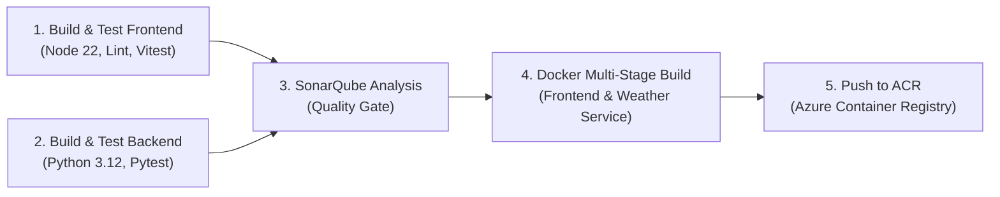

# Atmos — Weather Intelligence Dashboard

Atmos is a high-precision meteorological intelligence dashboard built as a lightweight, cloud-native monorepo. It pairs a React 18 / TypeScript frontend styled after aerospace telemetry consoles with a Python 3.12 / FastAPI backend that normalizes external weather and geospatial data from Open-Meteo and OpenStreetMap.

---

## Contents

- [Architecture](#architecture)
- [Design System & Anti-Vibecoding Rules](#design-system--anti-vibecoding-rules)
- [Repository Structure](#repository-structure)
- [Prerequisites](#prerequisites)
- [Local Setup with Docker Compose](#local-setup-with-docker-compose-recommended)
- [Run Without Docker](#run-without-docker)
- [API Endpoints](#api-endpoints)
- [Testing & Quality Assurance](#testing--quality-assurance)
  - [Backend Unit & Integration Tests (Pytest)](#backend-unit--integration-tests-pytest)
  - [Frontend Unit & Component Tests (Vitest)](#frontend-unit--component-tests-vitest)
  - [End-to-End Automation Tests (Playwright)](#end-to-end-automation-tests-playwright)
  - [SonarQube / SonarCloud Quality Gates](#sonarqube--sonarcloud-quality-gates)
- [Production Docker & Cloud Deployment](#production-docker--cloud-deployment)
  - [Multi-Stage Production Containers](#multi-stage-production-containers)
  - [CI/CD Pipelines (Azure Pipelines)](#cicd-pipelines-azure-pipelines)
  - [Azure Container Apps / Instances Deployment](#azure-container-apps--instances-deployment)
- [Common Commands](#common-commands)

---

## Architecture

Atmos uses a clean, stateless 2-tier architecture. User preferences, saved coordinates, and alert monitoring rules are stored locally in the browser via `localStorage`, eliminating the need for a separate database or user microservice.

```mermaid
flowchart TD
    subgraph Client ["Client Browser (React + TypeScript)"]
        UI["Atmos Dashboard Cockpit"]
        Storage[("Browser LocalStorage<br/>(Saved Pins, Units, Theme)")]
        UI <--> Storage
    end

    subgraph Backend ["Weather Service (Python / FastAPI :8001)"]
        API["FastAPI App (/api/v1/*)"]
        Provider["Open-Meteo & Overpass Adapter"]
        API --> Provider
    end

    subgraph External ["External Upstreams"]
        OM["Open-Meteo Forecast & Geocoding"]
        OSM["OpenStreetMap / Nominatim / Overpass"]
    end

    UI -->|HTTP / JSON| API
    Provider -->|Weather & Geocoding| OM
    Provider -->|Nearby Places / POIs| OSM
    UI -->|Reverse Geocoding (My Location)| OSM
```

### Components

| Component | Technology | Responsibility | Local Address |
|---|---|---|---|
| **Frontend** | React 18, TypeScript, Vite 6, Recharts | Telemetry cockpit dashboard UI, offline persistence | `http://localhost:5173` |
| **Weather Service** | Python 3.12, FastAPI, HTTPX, Pydantic v2 | Forecast normalization, city search, nearby exploration | `http://localhost:8001` |

---

## Design System & Anti-Vibecoding Rules

The Atmos frontend strictly adheres to professional design standards and avoids the **30 generic AI "vibe-coded" boilerplate anti-patterns**:

| Category | Anti-Pattern Avoided | Atmos Production Implementation |
|---|---|---|
| **Color & Theme** | Harsh gradients, rainbow coloring, neon/pastel schemes, "AI purple & black" | **Dark Cockpit Palette**: Deep charcoal canvas (`#161B1E`), architectural off-white sidebar (`#F4F6F8`), warm amber (`#FF9F43`) & cyan-teal (`#00D2D3`) telemetry accents. |
| **Typography** | Generic Inter / Geist / Space Grotesk defaults | **Dual Typography System**: `Plus Jakarta Sans` for clean UI labels and headings; `JetBrains Mono` for numeric metrics, timestamps, and coordinates. |
| **Borders & Elevation** | Blurry drop shadows, liquid glass, radial orbs, dot grids | **Precision Aerospace Borders**: Crisp 1px geometric borders (`rgba(255,255,255,0.08)`), flat contrast elevation, zero blurry radial orbs. |
| **Layout & Structure** | Bento grid marketing tropes, 3 feature cards in a row, fake terminal mockups | **Split Dual-Tone Cockpit**: Asymmetrical data hierarchy mirroring telemetry systems; compact card layouts with metric-density. |
| **Iconography & Polish** | Generic Lucide icons, sparkle icons (`✨`), emojis in UI | **Thin-Stroke Technical Glyphs**: Precise 1.5px stroke icons, SVG arc gauges for humidity/wind telemetry, zero emojis or sparkles in production UI. |
| **Loading States** | Spinner-only loading screens | **Structured SVG Skeleton Loaders**: Native SVG wireframes that preserve spatial layouts while fetching async weather data. |
| **Copy & Compliance** | "It's not X, it's Y" marketing copy, missing legal notices | **Domain-Grade Meteorological Labels & Attribution**: Explicit scientific units (`Relative Humidity (%)`, `Wind Speed (km/h)`, `Precipitation Probability (%)`) with Open-Meteo (CC BY 4.0) and OpenStreetMap (ODbL) licensing. |

---

## Repository Structure

```text
atmos/
├── .env.example                               # Local environment template
├── .gitignore                                 # Git ignore rules
├── docker-compose.yml                         # Local development Docker Compose
├── docker-compose.test.yml                    # Test runner Docker Compose
├── README.md                                  # Project documentation
├── docs/
│   └── ARCHITECTURE.md                        # Architecture documentation
├── frontend/
│   ├── Dockerfile                             # Local development Dockerfile
│   ├── Dockerfile.prod                        # Production multi-stage Dockerfile (Nginx)
│   ├── nginx.conf                             # Production Nginx SPA & security header config
│   ├── package.json                           # Dependencies, Vitest & Playwright scripts
│   ├── tsconfig.json                          # TypeScript compiler configuration
│   ├── vite.config.ts                         # Vite configuration
│   ├── vitest.config.ts                       # Vitest unit/component test configuration
│   ├── playwright.config.ts                   # Playwright E2E automation configuration
│   ├── e2e/
│   │   └── dashboard.spec.ts                  # Playwright E2E test suite
│   └── src/
│       ├── __tests__/
│       │   └── App.test.tsx                   # Vitest / Testing Library smoke test
│       ├── api.ts                             # Weather Service API client
│       ├── App.tsx                            # Cockpit Dashboard component
│       ├── main.tsx                           # Application entry point
│       ├── styles.css                         # Dark Cockpit design system styles
│       ├── types.ts                           # Weather & location TypeScript interfaces
│       └── vite-env.d.ts                      # Vite environment declarations
├── services/
│   └── weather-service/
│       ├── Dockerfile                         # Local development Dockerfile
│       ├── Dockerfile.prod                    # Production multi-stage Dockerfile (non-root)
│       ├── requirements.txt                   # FastAPI & dependencies
│       ├── pytest.ini                         # Pytest configuration
│       ├── app/
│       │   ├── __init__.py
│       │   ├── main.py                        # FastAPI routes & handlers
│       │   └── providers/
│       │       ├── __init__.py
│       │       └── open_meteo.py              # Open-Meteo API adapter
│       └── tests/
│           ├── conftest.py                    # Pytest shared fixtures & API mocks
│           ├── test_health.py                 # Health endpoint unit test
│           └── test_weather_api.py            # Comprehensive weather & search test suite
└── pipelines/
    ├── ci.yml                                 # Unified 5-stage Azure DevOps CI pipeline
    ├── cd.yml                                 # Azure Container Apps CD deployment pipeline
    ├── sonar-frontend.yml                     # Standalone frontend SonarQube pipeline
    └── sonar-weather-service.yml              # Standalone weather service SonarQube pipeline
```

---

## Prerequisites

- **Docker Desktop** (with Docker Compose)
- *Optional for non-Docker host execution:* **Node.js 22+**, **Python 3.12+**

---

## Local Setup with Docker Compose (Recommended)

### 1. Start the stack

```bash
docker compose up --build -d
```

### 2. Verify containers

```bash
docker compose ps
```

### 3. Access applications

| Purpose | URL |
|---|---|
| **Atmos Dashboard** | [http://localhost:5173](http://localhost:5173) |
| **Weather Service OpenAPI Docs** | [http://localhost:8001/docs](http://localhost:8001/docs) |
| **Weather Service Health Check** | [http://localhost:8001/health](http://localhost:8001/health) |

### 4. Stop the stack

```bash
docker compose down
```

---

## Run Without Docker

### 1. Weather Service

```bash
cd services/weather-service
python -m venv .venv

# Linux/macOS
source .venv/bin/activate
# Windows PowerShell
.\.venv\Scripts\Activate.ps1

pip install -r requirements.txt
uvicorn app.main:app --reload --port 8001
```

### 2. Frontend

In a separate terminal:

```bash
cd frontend
npm install
npm run dev
```

Open [http://localhost:5173](http://localhost:5173).

---

## API Endpoints

### Weather Service (Port 8001)

| Method | Endpoint | Description |
|---|---|---|
| `GET` | `/health` | Service health status |
| `GET` | `/api/v1/locations/search?q={query}` | Search cities via Open-Meteo Geocoding |
| `GET` | `/api/v1/weather?latitude={lat}&longitude={lon}&name={name}&country={country}` | Normalized current, hourly (24h), and 7-day forecast |
| `GET` | `/api/v1/explore/nearby?latitude={lat}&longitude={lon}&temperature={t}&rain_probability={r}&weather_code={c}&wind_speed={w}` | Nearby attractions with weather-aware planning hints |

---

## Testing & Quality Assurance

### Backend Unit & Integration Tests (Pytest)

The backend test suite verifies endpoint behavior, input validation, and upstream error handling with mocked external HTTP clients.

```bash
cd services/weather-service
pip install pytest pytest-cov pytest-asyncio
pytest --cov=app --cov-report=xml:coverage.xml --cov-report=term
```

### Frontend Unit & Component Tests (Vitest)

Vitest tests verify component rendering, offline localStorage persistence, and telemetry displays:

```bash
cd frontend
npm run test
# Or with coverage reporting:
npm run test:coverage
```

### End-to-End Automation Tests (Playwright)

Playwright runs cross-browser E2E automation tests verifying:
- Dashboard initial rendering and metric hydration
- City search and dynamic forecast switching
- View navigation (Overview, Forecast, Explore, Alerts, Settings)
- LocalStorage bookmarking and theme toggling

```bash
cd frontend
# Install Playwright browsers (first time)
npx playwright install --with-deps

# Run automated tests
npm run test:e2e

# Interactive UI test runner
npm run test:e2e:ui
```

### SonarQube / SonarCloud Quality Gates

Both services generate standardized coverage reports:
- **Backend:** `services/weather-service/coverage.xml` (Cobertura XML format)
- **Frontend:** `frontend/coverage/lcov.info` (LCOV format)

These are automatically ingested by `pipelines/ci.yml` and the dedicated SonarQube pipelines (`pipelines/sonar-frontend.yml`, `pipelines/sonar-weather-service.yml`).

---

## Production Docker & Cloud Deployment

### Multi-Stage Production Containers

Production builds use optimized multi-stage Dockerfiles:

1. **Frontend (`frontend/Dockerfile.prod`):**
   - Stage 1: Compiles TypeScript and builds minified assets using Node 22 Alpine.
   - Stage 2: Packages assets into a lightweight `nginx:alpine` image with SPA fallback, gzip compression, and security headers (CSP, X-Frame-Options, HSTS).
   - Serves on port `80` with built-in healthchecks.

2. **Weather Service (`services/weather-service/Dockerfile.prod`):**
   - Uses `python:3.12-slim`.
   - Runs under a restricted, unprivileged `appuser`.
   - Multi-worker production Uvicorn server with container healthchecks.

To build production images locally:

```bash
# Build Frontend production image
docker build -f frontend/Dockerfile.prod -t atmos-frontend:latest ./frontend

# Build Weather Service production image
docker build -f services/weather-service/Dockerfile.prod -t atmos-weather-service:latest ./services/weather-service
```

### CI/CD Pipelines (Azure Pipelines)

The repository includes a comprehensive 5-stage Azure DevOps pipeline in `pipelines/ci.yml`:



### Azure Container Apps / Instances Deployment

Continuous deployment is automated via `pipelines/cd.yml`, which deploys container images to **Azure Container Apps (ACA)**:

1. **Azure Container Registry (ACR):** Houses versioned, tagged production images.
2. **Azure Container Apps Environment:**
   - Host `atmos-weather-service` with internal/external ingress, automatic scale-to-zero, and CPU/memory quotas.
   - Host `atmos-frontend` pointing to the weather service backend URL.
3. **Health Probes:** Liveness and readiness HTTP probes verify `/health` and `/` endpoints prior to routing traffic.

---

## Common Commands

```bash
# Local development with Docker
docker compose up --build -d
docker compose logs -f
docker compose down

# Run full test suite via Docker Compose
docker compose -f docker-compose.test.yml up --build --abort-on-container-exit

# Frontend commands
cd frontend
npm run lint          # TypeScript type check
npm run test          # Vitest unit tests
npm run test:e2e      # Playwright E2E tests
npm run build         # Production bundle build

# Backend commands
cd services/weather-service
pytest                # Pytest unit tests with coverage
```
