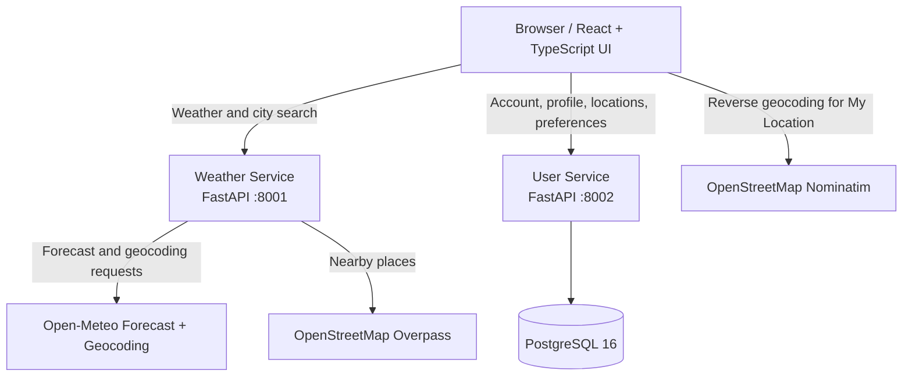

# Atmos — Weather Intelligence

Atmos is a weather dashboard built as a small monorepo. It combines a React/TypeScript frontend, two FastAPI services, PostgreSQL for local persistence, and external weather/place data providers.

This README documents the project as it exists in this repository. Planned cloud infrastructure and future features are called out separately rather than described as already implemented.

## Contents

- [Features](#features)
- [Architecture](#architecture)
- [Repository structure](#repository-structure)
- [Prerequisites](#prerequisites)
- [Local setup with Docker Compose](#local-setup-with-docker-compose-recommended)
- [Run without Docker](#run-without-docker)
- [Application workflow](#application-workflow)
- [API endpoints](#api-endpoints)
- [Configuration](#configuration)
- [Tests and code quality](#tests-and-code-quality)
- [Common commands](#common-commands)
- [Troubleshooting](#troubleshooting)
- [Security and known limitations](#security-and-known-limitations)
- [Roadmap and cloud deployment status](#roadmap-and-cloud-deployment-status)

## Features

The current frontend includes:

- **Overview:** current conditions and weather summary.
- **Forecast:** hourly and seven-day forecast views.
- **Explore:** city search and nearby attractions with weather-aware planning notes.
- **My Location:** uses browser geolocation when the user grants permission; reverse geocoding is requested from OpenStreetMap's Nominatim service.
- **Alerts:** lets the user configure local weather alert rules in the browser. This is not a server-side alert delivery system.
- **Settings:** display preferences and profile-related UI.
- **Accounts:** email/password registration, login, logout, and profile update endpoints.
- **Saved locations and preferences:** API-backed endpoints using the User Service and PostgreSQL.
- **Responsive dark/light dashboard UI.**

Weather search and forecasts use Open-Meteo. Nearby Explore places are requested from OpenStreetMap's Overpass service. Provider availability, coverage, usage limits, attribution and licensing should be reviewed before public or commercial use.

## Architecture



### Components

| Component | Technology | Responsibility | Local address |
|---|---|---|---|
| Frontend | React, TypeScript, Vite | Dashboard UI and browser interactions | `http://localhost:5173` |
| Weather Service | Python, FastAPI, HTTPX | City search, forecast normalization, nearby Explore results | `http://localhost:8001` |
| User Service | Python, FastAPI, SQLAlchemy, psycopg | Registration/login, session endpoints, profile, saved locations and preferences | `http://localhost:8002` |
| Database | PostgreSQL 16 Alpine | Persistent User Service data | `localhost:5432` |

The Weather Service isolates the Open-Meteo integration behind `services/weather-service/app/providers/open_meteo.py`. The frontend calls the services through the API helpers in `frontend/src/api.ts`.

## Repository structure

```text
atmos/
├── .env.example
├── .gitignore
├── docker-compose.yml
├── README.md
├── docs/
│   └── ARCHITECTURE.md
├── frontend/
│   ├── Dockerfile
│   ├── package.json
│   ├── index.html
│   ├── vite.config.ts
│   └── src/
│       ├── App.tsx
│       ├── api.ts
│       ├── main.tsx
│       ├── styles.css
│       ├── types.ts
│       └── vite-env.d.ts
├── services/
│   ├── user-service/
│   │   ├── Dockerfile
│   │   ├── requirements.txt
│   │   └── app/
│   │       ├── __init__.py
│   │       └── main.py
│   └── weather-service/
│       ├── Dockerfile
│       ├── requirements.txt
│       ├── app/
│       │   ├── __init__.py
│       │   ├── main.py
│       │   └── providers/
│       │       └── open_meteo.py
│       └── tests/
│           └── test_health.py
└── pipelines/
    ├── sonar-frontend.yml
    └── sonar-weather-service.yml
```

Generated `__pycache__` directories and `.pyc` files are runtime artifacts and should not be committed.

## Prerequisites

### Recommended: Docker Compose

Install:

1. **Git** — to clone the repository.
2. **Docker Desktop with Docker Compose** on Windows/macOS, or **Docker Engine plus the Docker Compose plugin** on Linux/WSL2.
3. An internet connection so containers can download base images and the services can reach weather/geocoding/place providers.

With the Docker Compose route, you do **not** need to install Node.js, Python, or PostgreSQL separately on the host. The Dockerfiles use Node.js 22 Alpine for the frontend and Python 3.12 slim for the FastAPI services; Compose starts PostgreSQL 16 Alpine.

Verify installations:

```bash
git --version
docker --version
docker compose version
```

Make sure Docker is running before starting the app.

### Optional: run services directly on your computer

For the non-Docker route, install:

- Node.js 22 or newer and npm.
- Python 3.12 or newer.
- PostgreSQL 16, running locally or available through a connection string.

Verify:

```bash
node --version
npm --version
python --version
```

On some Linux systems, the Python executable is named `python3`; use `python3` in the virtual-environment commands if needed.

## Local setup with Docker Compose (recommended)

### 1. Get the source code

Clone your repository, then enter the project root (the directory containing `docker-compose.yml`):

```bash
git clone <YOUR-REPOSITORY-URL>
cd atmos
```

If you already have the source ZIP, extract it and open a terminal in the extracted `atmos` directory instead.

### 2. Configure local environment variables

Create your local environment file from the template:

```bash
cp .env.example .env
```

Open `.env` and set `POSTGRES_PASSWORD` to a new, strong local development password. Keep `COOKIE_SECURE=false` for local HTTP development only.

**Never commit `.env`.** Commit `.env.example` with placeholder values only; do not put real passwords or credentials in the template.

PowerShell alternative:

```powershell
Copy-Item .env.example .env
```

The Compose file has local defaults, but using a private `.env` file makes the local configuration explicit.

### 3. Build and start the app

From the repository root:

```bash
docker compose up --build -d
```

Check container status:

```bash
docker compose ps
```

Follow all service logs:

```bash
docker compose logs -f
```

Follow one service:

```bash
docker compose logs -f frontend
docker compose logs -f weather-service
docker compose logs -f user-service
docker compose logs -f postgres
```

### 4. Open the application

| Purpose | URL |
|---|---|
| Atmos frontend | http://localhost:5173 |
| Weather Service Swagger UI | http://localhost:8001/docs |
| Weather Service health check | http://localhost:8001/health |
| User Service Swagger UI | http://localhost:8002/docs |
| User Service health check | http://localhost:8002/health |

The APIs are also documented by FastAPI's OpenAPI interface at `/openapi.json` on each API port.

### 5. Try the main flows

1. Open the frontend.
2. Search for a city and select a result.
3. Review the Overview and Forecast screens.
4. Open Explore and allow location access if you want to use My Location; otherwise search for a city.
5. Try account registration and login with a development account.
6. Try saving a location and updating preferences.
7. Open the API `/docs` pages to inspect and call endpoints directly.

The weather and place features require internet access to the external providers.

### 6. Stop the application

Stop containers but preserve the PostgreSQL volume:

```bash
docker compose down
```

Start again later:

```bash
docker compose up -d
```

To rebuild after changing source code or a Dockerfile:

```bash
docker compose up --build -d
```

**Database warning:** `docker compose down -v` deletes the Compose-managed PostgreSQL volume and its local database data. Do not use it unless you deliberately want to reset the local database.

## Run without Docker

Use this option if you want to run each component directly. You still need PostgreSQL running and configured for the User Service.

### 1. Start PostgreSQL

Create a local database and user matching the configuration used by the User Service, or set the environment variables to match your own database. The Compose setup uses database `atmos` and username `atmos`.

For an environment variable based configuration, the User Service reads `POSTGRES_USER`, `POSTGRES_PASSWORD`, and `POSTGRES_DB`. Configure them in the shell before launching the service. Avoid putting secrets in source control.

### 2. Start the Weather Service

Linux/macOS/WSL:

```bash
cd services/weather-service
python3 -m venv .venv
source .venv/bin/activate
pip install -r requirements.txt
uvicorn app.main:app --reload --port 8001
```

Windows PowerShell:

```powershell
cd services/weather-service
py -3.12 -m venv .venv
.\.venv\Scripts\Activate.ps1
pip install -r requirements.txt
uvicorn app.main:app --reload --port 8001
```

Leave this terminal running.

### 3. Start the User Service

Open another terminal from the repository root.

Linux/macOS/WSL:

```bash
cd services/user-service
python3 -m venv .venv
source .venv/bin/activate
pip install -r requirements.txt
```

Set the database environment variables for your local PostgreSQL instance before launching. For example, in Bash:

```bash
export POSTGRES_USER=atmos
export POSTGRES_PASSWORD='<YOUR_LOCAL_DATABASE_PASSWORD>'
export POSTGRES_DB=atmos
export COOKIE_SECURE=false
```

Then start the service:

```bash
uvicorn app.main:app --reload --port 8002
```

Windows PowerShell environment-variable example:

```powershell
$env:POSTGRES_USER = "atmos"
$env:POSTGRES_PASSWORD = "<YOUR_LOCAL_DATABASE_PASSWORD>"
$env:POSTGRES_DB = "atmos"
$env:COOKIE_SECURE = "false"
uvicorn app.main:app --reload --port 8002
```

Leave this terminal running. If a password contains URL-reserved characters, check how the application's database connection string is constructed and URL-encode the password if required.

### 4. Start the frontend

Open a third terminal:

```bash
cd frontend
npm install
```

Create `frontend/.env.local` with:

```env
VITE_WEATHER_API_URL=http://localhost:8001
VITE_USER_API_URL=http://localhost:8002
```

Start Vite:

```bash
npm run dev
```

Open http://localhost:5173.

### Frontend scripts

Run these from `frontend/`:

```bash
npm run dev
npm run lint
npm run build
npm run preview
```

- `dev` starts the Vite development server.
- `lint` runs TypeScript validation (`tsc --noEmit`).
- `build` runs TypeScript project checks and builds the frontend.
- `preview` serves a previously built frontend for local preview.

## Application workflow

### Weather lookup and forecast

1. A user searches for a city in the frontend.
2. `frontend/src/api.ts` calls `GET /api/v1/locations/search` on the Weather Service.
3. The Weather Service calls Open-Meteo's geocoding API and normalizes the returned city/location fields.
4. After a location is selected, the frontend calls `GET /api/v1/weather` with latitude, longitude, name and country.
5. The Weather Service calls Open-Meteo's forecast API, transforms current, hourly and daily values into the app's response schema, and returns the result.
6. The frontend renders the current conditions, hourly forecast and seven-day forecast.

The service returns up to 24 hourly entries and up to seven daily entries from the provider response.

### My Location and Explore

1. The browser requests permission to access the user's location.
2. If permission is granted, the frontend obtains coordinates and asks OpenStreetMap Nominatim for a place label.
3. The frontend requests current weather for those coordinates.
4. Explore calls `GET /api/v1/explore/nearby` on the Weather Service with coordinates and current weather inputs.
5. The Weather Service queries OpenStreetMap's Overpass service for nearby attractions, calculates approximate distances, sorts results by distance, and attaches weather-aware planning notes.
6. The frontend shows results and map links.

Geolocation requires a supported browser and permission. Browser geolocation generally requires a secure context, with `localhost` treated as a development exception. External map coverage varies by area.

### Registration, login and profile

1. The frontend submits registration or login details to the User Service.
2. The service validates the request and stores password hashes rather than plaintext passwords.
3. On successful registration/login, the service creates a session using an HTTP-only cookie.
4. The frontend can request the current account through `GET /api/v1/auth/me`.
5. Profile updates are sent to `PUT /api/v1/profile`.

This version does not use SMTP, email verification or Google OAuth. Registration activates the account immediately.

### Saved locations and preferences

The frontend calls the User Service to list, add and remove saved locations and to read/update preferences. The service persists these values in PostgreSQL. See the security limitations below: these resources currently use a global scope rather than authenticated per-user ownership.

### Alerts and browser-stored settings

Alert rules and some UI/profile state are stored in browser `localStorage` in the current frontend. They are not a server-side alerting/notification pipeline and may be specific to the browser profile. Do not assume alert rules are delivered as notifications.

## API endpoints

Interactive request schemas and response models are available from the Swagger UI links above.

### Weather Service — port 8001

| Method | Endpoint | Purpose |
|---|---|---|
| `GET` | `/health` | Service health |
| `GET` | `/api/v1/locations/search?q=<city>` | Search locations using Open-Meteo geocoding |
| `GET` | `/api/v1/weather?latitude=<lat>&longitude=<lon>&name=<name>&country=<country>` | Current, hourly and daily forecast |
| `GET` | `/api/v1/explore/nearby` | Find nearby attractions and generate weather-aware notes |

### User Service — port 8002

| Method | Endpoint | Purpose |
|---|---|---|
| `GET` | `/health` | Service health |
| `POST` | `/api/v1/auth/register` | Register and start a session |
| `POST` | `/api/v1/auth/login` | Log in and start a session |
| `GET` | `/api/v1/auth/me` | Return the current session's user |
| `PUT` | `/api/v1/profile` | Update profile fields |
| `POST` | `/api/v1/auth/logout` | End the current session |
| `GET` | `/api/v1/locations` | List saved locations |
| `POST` | `/api/v1/locations` | Save a location |
| `DELETE` | `/api/v1/locations` | Remove a saved location by coordinates |
| `GET` | `/api/v1/preferences` | Read preferences |
| `PUT` | `/api/v1/preferences` | Update preferences |

## Configuration

### Docker Compose environment variables

| Variable | Purpose | Local guidance |
|---|---|---|
| `POSTGRES_PASSWORD` | Password used by the local PostgreSQL container and User Service | Set a unique local development value in `.env` |
| `COOKIE_SECURE` | Controls whether session cookies require HTTPS | `false` for local HTTP; use `true` behind HTTPS in an appropriate production setup |
| `CORS_ORIGINS` | Allowed browser origin for the APIs | Compose sets `http://localhost:5173` |
| `VITE_WEATHER_API_URL` | Weather API base URL used by the frontend | Compose sets `http://localhost:8001` |
| `VITE_USER_API_URL` | User API base URL used by the frontend | Compose sets `http://localhost:8002` |

For local direct frontend development, `VITE_WEATHER_API_URL` and `VITE_USER_API_URL` belong in `frontend/.env.local`. Vite exposes variables prefixed with `VITE_` to frontend code, so do not put secrets in those variables.

## Tests and code quality

### Weather Service test

From the repository root:

```bash
cd services/weather-service
python3 -m venv .venv
source .venv/bin/activate
pip install -r requirements.txt
pip install pytest
pytest
```

The current test suite includes a health-endpoint test in `tests/test_health.py`.

For Windows PowerShell, activate the environment using `.\.venv\Scripts\Activate.ps1` instead of `source .venv/bin/activate`.

### Frontend checks

```bash
cd frontend
npm install
npm run lint
npm run build
```

### Azure DevOps SonarQube pipeline examples

The repository contains:

- `pipelines/sonar-frontend.yml`
- `pipelines/sonar-weather-service.yml`

These are starter pipeline examples. The configured SonarQube service connection name (`Atmos-SonarQube`) and SonarQube server/project configuration must exist in Azure DevOps. The frontend pipeline uses `npm ci`, which requires a committed `package-lock.json`; generate and commit a lockfile if you intend to run that pipeline as written. Do not consider a quality gate active until the pipeline has run successfully and its results have been checked.

## Common commands

Run from the repository root unless otherwise stated.

```bash
# Start and build all containers
docker compose up --build -d

# Show service/container status
docker compose ps

# Follow all logs
docker compose logs -f

# Follow a specific service
docker compose logs -f user-service

# Restart a single service
docker compose restart weather-service

# Rebuild and recreate one service
docker compose up --build -d user-service

# Stop containers, preserving the database volume
docker compose down

# Stop and delete the local database volume (destructive)
docker compose down -v
```

## Troubleshooting

### Frontend loads but weather data is unavailable

- Confirm the Weather Service is running: `docker compose ps`.
- Check logs: `docker compose logs -f weather-service`.
- Open `http://localhost:8001/health` and `http://localhost:8001/docs`.
- Check internet access and Open-Meteo availability.

### Login/profile requests fail

- Check `docker compose logs -f user-service`.
- Check PostgreSQL health: `docker compose ps postgres`.
- Confirm the `POSTGRES_PASSWORD` value used by the User Service matches the password used by the PostgreSQL database.
- If you changed the password after the PostgreSQL volume was initialized, changing `.env` alone does not change the password inside the existing database volume. Update the database password deliberately or reset the local volume only if you are willing to lose its data.

### Browser reports CORS errors

- Ensure the frontend is opened at `http://localhost:5173`.
- The current Compose configuration sets the API CORS origin to that address.
- If you change the frontend port/origin, update the `CORS_ORIGINS` values for the relevant services.

### Port already in use

Check whether another process is using `5173`, `8001`, `8002` or `5432`. Stop the conflicting process or adjust the Compose port mappings and the frontend API URLs consistently.

### My Location does not work

- Grant location permission to the browser.
- Use `localhost` or an HTTPS origin.
- Check browser developer tools and internet connectivity to Nominatim and the Weather Service.

### Changes do not appear after editing

- Frontend source edits should normally be picked up by Vite.
- For dependency or Dockerfile changes, rebuild the relevant container with `docker compose up --build -d <service>`.
- Inspect logs for startup or build errors.

## Security and known limitations

Atmos is an **MVP/local-development project**, not a production-ready public service.

- **User-data isolation is incomplete:** saved locations and preferences currently use a global scope rather than being securely associated with each authenticated user. Do not expose these endpoints publicly or store real user data until per-user ownership and authorization are implemented.
- **Production security work remains:** review CSRF protections for cookie-based sessions, rate limiting, password recovery, session lifecycle, security headers, logging, and database migrations before deployment.
- **No email verification or SMTP:** registration starts a session immediately in this version.
- **Alerts are not delivered server-side:** browser-stored rules do not constitute an alert delivery system.
- **Profile/UI storage is mixed:** some frontend state uses browser `localStorage`, while profile and account flows also use API endpoints. Confirm which values are persisted by each flow before relying on cross-device behavior.
- **External providers:** Open-Meteo and OpenStreetMap services depend on internet access and their own terms, usage policies, availability and data coverage.
- **No production cloud infrastructure is included:** AKS, Terraform modules, Key Vault integration, production identity, and deployed Azure resources are not provisioned by this starter.
- **Sonar pipelines are examples:** service connections, quality gates and pipeline prerequisites must be configured and validated.

Never commit `.env` or real credentials. If a secret was previously pushed to source control, rotate it; adding `.gitignore` does not remove a secret from Git history.

## Roadmap and cloud deployment status

The architecture documentation describes possible future work, including:

1. Per-user data ownership and authorization across user resources.
2. Database migrations and broader automated tests.
3. Security hardening and dependency/secret/container scanning.
4. Expanded weather features such as alerts and air-quality integrations.
5. Terraform modules and AKS manifests.
6. Azure deployment and secret management using appropriate identity controls.
7. Observability, operational alerts and future AI capabilities.

These are roadmap items, not features that should be assumed to be implemented in the current local starter. Review `docs/ARCHITECTURE.md` before making architectural changes.
